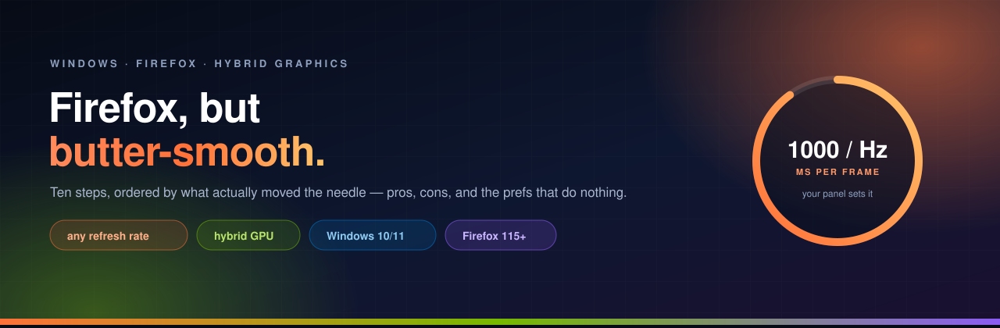
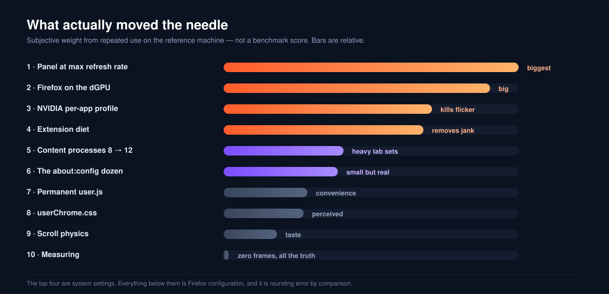
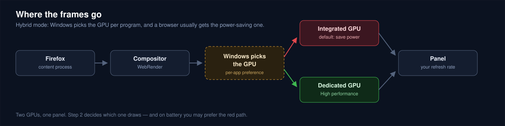
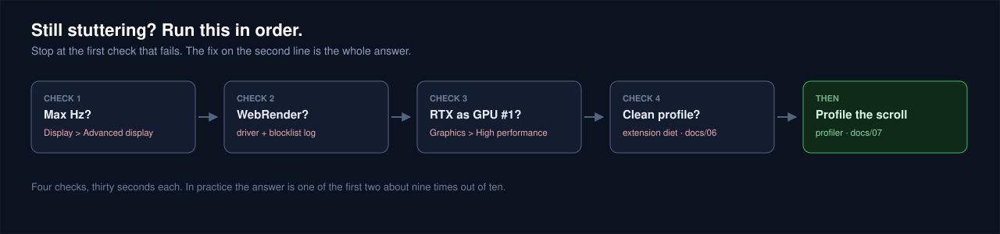
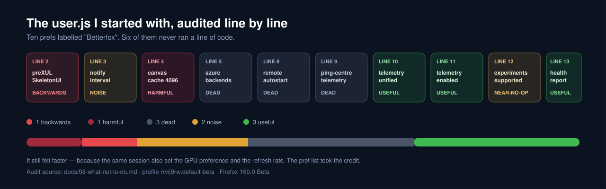

<div align="center">
  
</div>

<div align="center">


</div>

<br>

<div align="center">
  <b>Ten steps, ranked by what actually moved the needle.</b><br>
  <sub>Each with pros, cons, an honest impact rating and a one-line undo. Plus a line-by-line audit of a generated pref list — six of its ten lines never ran.</sub>
</div>

---

## ⚡ The 30-second version

| | Do this | Where | Gain |
|:-:|:--|:--|:--|
| **1** | Confirm the panel is at its **max refresh rate** — not 60 | `Settings → Display → Advanced display` | 🔥🔥🔥 |
| **2** | Point `firefox.exe` at the **dedicated GPU** | `Settings → Display → Graphics` | 🔥🔥 |
| **3** | **DXGI swapchain** present method | NVIDIA Control Panel → Firefox | 🔥 kills the flicker |
| **4** | **One** content blocker — uBlock Origin | Firefox → Add-ons | 🔥 less jank |

> **If you only do one thing:** make sure the panel is really running at its maximum refresh rate. Everything else on this page is polishing a frame budget measured in single-digit milliseconds.

### What your frame budget actually is

| Your panel | Frame budget |
|:-:|:-:|
| 60 Hz | 16.7 ms |
| 144 Hz | 6.9 ms |
| 165 Hz | 6.1 ms |
| 240 Hz | 4.2 ms |
| 360 Hz | 2.8 ms |

The higher the refresh rate, the less slack you get. At 60 Hz a 4 ms main-thread block disappears into the budget. At 240 Hz it is most of a frame. On a 360 Hz panel it is a visible stutter.

That reframes the whole guide:

- An extension that blocks the main thread for a few ms is invisible at 60 Hz and obvious on a high-refresh panel.
- Content process count matters more than it looks: less per-process work means less chance of a multi-millisecond hitch.
- `layout.frame_rate` must stay at `-1`. Pinning it to a number takes the compositor off the vsync path, which is where judder and tearing come from.

---

## 📊 What actually moved the needle

<div align="center">
  
</div>

---

## 🧭 Where the frames go

This is the whole reason steps 1–3 exist. In hybrid (Advanced Optimus) mode, Windows picks the GPU per program, and a browser usually gets the iGPU:

<div align="center">
  
</div>

And when it still stutters, this is the order that finds the cause:

<div align="center">
  
</div>

---

## 🖥️ Where the numbers come from

Every rating on this page was measured on one machine. It is a reference point, not a requirement — nothing here is tuned to that hardware, and each step says how to size it for yours.

| | |
|:--|:--|
| **Type** | gaming laptop, hybrid graphics (Advanced Optimus) |
| **GPU** | dGPU + iGPU pair — any such pair behaves the same way |
| **Panel** | 1920 × 1080 at 360 Hz → 2.78 ms frame budget |
| **RAM / CPU** | 16 GB, 14 cores / 20 threads |
| **Browser** | Firefox 160.0 Beta — prefs move, your build may differ |

> Higher refresh rates need more link bandwidth. 1080p at 360 Hz fits DisplayPort 1.4 and internal eDP, but not HDMI 2.0 (which tops out near 240 Hz at that resolution). If Windows offers less than your panel's spec, check the cable and port before blaming Firefox.

---

## 🪜 The ten steps

Each step carries two badges: **impact** in practice, and **risk** to you.

### 01 · Run the panel at its maximum refresh rate

 

**Why:** the compositor can only draw as fast as the panel is clocked. Windows drops back to 60 Hz after driver updates, dock changes and display-mode switches, and it never tells you.

**Do:** `Win + I` → **System → Display → Advanced display** → **Choose a refresh rate** → pick the highest listed (60 / 120 / 144 / 165 / 240 / 360 — whatever your panel and cable allow).

| ✅ Pros | ⚠️ Cons |
|:--|:--|
| Biggest single improvement available, and free | More idle power; a 360 Hz panel is thirsty |
| Fixes stutter in *every* app, not just Firefox | Some panels downclock on battery by design |
| One click, instantly reversible | You will notice 60 Hz forever afterwards |

**↩️ Undo:** pick `60 Hz` in the same dropdown.

---

### 02 · Point Firefox at the dedicated GPU

 

**Why:** a browser is assumed to be a battery-friendly app and gets the iGPU. Forcing the dGPU gives Firefox the fill rate for compositing, canvas and video decode.

**Do:** `Win + I` → **System → Display → Graphics** → **Browse** → `C:\Program Files\Mozilla Firefox\firefox.exe` (or wherever yours lives) → **Options** → **High performance** → **Save**.

| ✅ Pros | ⚠️ Cons |
|:--|:--|
| Removes the biggest stutter source on hybrid laptops | Battery life drops — the dGPU idles higher than the iGPU |
| Makes hardware decode and GPU raster actually reachable | More heat, fans sooner |
| No registry, no driver mods | Games now share a busier GPU |

**↩️ Undo:** same screen → **Let Windows decide**.

---

### 03 · NVIDIA Control Panel: one profile, two fixes

 

**Why:** Windows decides *which* GPU; the driver decides *how*. Its default power management lets clocks fall between frames, and on Optimus it can pick the wrong present path and flicker.

**Do:** `Manage 3D Settings → Program Settings → Add → Mozilla Firefox`:

| Setting | Value | Why |
|:--|:--|:--|
| Preferred graphics processor | High-performance NVIDIA processor | belt and braces with step 2 |
| Power management mode | Prefer maximum performance | stops clock ramping between frames |
| Max Frame Rate | Off, or = your panel Hz | never let a background app get capped to 20–30 |
| Vulkan/OpenGL present method | **Prefer layered on DXGI Swapchain** | the actual fix for black-flash-on-alt-tab |
| Vertical sync | Use the 3D application setting | forcing Off tears |

| ✅ Pros | ⚠️ Cons |
|:--|:--|
| The DXGI present method kills the classic Optimus flicker | Max-performance keeps the GPU clocked up: hotter idle |
| Per-program, so other apps keep normal power behaviour | On some driver branches DXGI breaks full-screen games — keep it Firefox-only |
| Survives driver updates better than registry hacks | One more thing to redo after a clean install |

**↩️ Undo:** NVIDIA CP → Firefox → **Remove**.

---

### 04 · Firefox's own Performance panel

 

**Why:** every pref list jumps to `about:config` and skips the GUI that actually owns the process model. `dom.ipc.processCount` is ignored while "Use recommended performance settings" is ticked.

**Do:** `about:preferences` → **General → Performance** → uncheck **Use recommended performance settings** → keep **Use hardware acceleration when available** checked → **Content process limit** = `8` by default, `12` if you have 16 GB or more.

| ✅ Pros | ⚠️ Cons |
|:--|:--|
| The only supported way to change the process limit | More processes = more RAM (~3 GB of content at 12) |
| Costs nothing, breaks nothing | Turning hardware accel *off* here is a common self-own |
| Makes the limit survive a restart | 16 is past the point of returns on 16 GB |

**↩️ Undo:** re-tick **Use recommended performance settings**.

---

### 05 · The `about:config` dozen

 

**Why:** this is the 60%-placebo part of the internet. These twelve are the ones that still exist *and* do something. Full table with defaults and verdicts: **[docs/03](docs/03-about-config.md)**.

| Pref | Set to | What it does |
|:--|:-:|:--|
| `gfx.canvas.accelerated.cache-size` | `512` | VRAM budget for canvas, MB (256 default; keep 256 on 4 GB cards) |
| `gfx.webrender.software` | `false` | refuse software compositing |
| `gfx.direct2d.disabled` | `false` | keep Direct2D on |
| `dom.ipc.processCount` | `12` | content processes for 20 threads |
| `browser.tabs.unloadOnLowMemory` | `true` | collapse background tabs under pressure |
| `browser.sessionstore.interval` | `60000` | session writes every 60 s, not 15 s |
| `nglayout.initialpaint.delay` | `0` | paint immediately (default 5 ms) |
| `nglayout.initialpaint.delay.composite` | `0` | same, compositor path |
| `general.smoothScroll.msdPhysics.enabled` | `true` | newer scroll physics |
| `media.hardware-video-decoding.enabled` | `true` | use the GPU's decoders |
| `media.wmf.hevc.enabled` | `1` | HEVC via Media Foundation |
| `layers.acceleration.draw-fps` | `true` | **temporary** — FPS overlay, for step 10 |

| ✅ Pros | ⚠️ Cons |
|:--|:--|
| Small honest gains: less paint latency, less disk churn | Several are unfeelable — you will not notice sessionstore |
| All reversible in the same panel | Unsupported surface: Mozilla renames these freely |
| One gives you a frame counter | Copying a stranger's list is how 300-line junk files happen |

**↩️ Undo:** right-click each row → **Reset**.

---

### 06 · Make it permanent with `user.js`

 

**Why:** `about:config` edits survive updates but not a profile refresh. A `user.js` re-applies a known-good set at every start — and moves your setup to a new machine in one file.

**Do:**

```powershell
.\scripts\Install-FirefoxTune.ps1
```

| ✅ Pros | ⚠️ Cons |
|:--|:--|
| Reproducible: same browser on any machine | **It overrides the UI** — change a pref and it reverts next launch |
| Self-documenting: every line says why | One more thing to remember after a Firefox update |
| Delete the file and you are back to stock | Dead prefs pile up silently |

**↩️ Undo:** delete `user.js` from the profile folder (or run `Restore-FirefoxTune.ps1`).

---

### 07 · `userChrome.css`: snappier menus

 

**Why:** panel and menu animations are tuned for 60 Hz. On 360 Hz that fade *is* the latency.

**Do:** `about:config` → `toolkit.legacyUserProfileCustomizations.stylesheets` = `true`, then drop [`chrome/userChrome.css`](chrome/userChrome.css) into the profile's `chrome/` folder and restart.

| ✅ Pros | ⚠️ Cons |
|:--|:--|
| Menus open on the frame you click | **Unsupported API** — breaks silently after UI updates |
| Tabs stop fading | Parsed per window: a big stylesheet slows startup |
| Pure CSS, no extension, no process | Can break panel positioning on mixed-DPI multi-monitor |

**↩️ Undo:** delete the file, restart.

---

### 08 · Extension diet

 

**Why:** every extension injects code into pages. Content blockers and style injectors are the two that show up in scroll profiles.

**Do:**

- **One** blocker: uBlock Origin. Remove AdBlock, AdBlock Plus, Ghostery, Privacy Badger — two blockers means two filter passes per request.
- Delete anything that injects CSS/DOM into every page: dark-mode forcers, font replacers, **"smooth scroll" extensions** (those reimplement scrolling in JS, outside APZ — always worse).
- Keep filter lists lean.

| ✅ Pros | ⚠️ Cons |
|:--|:--|
| Cheapest real CPU win in the list | One site will break and you'll blame the wrong thing |
| Less memory, fewer timers, fewer mystery requests | Losing "redundancy" feels wrong and is free |

**↩️ Undo:** reinstall whatever you removed.

---

### 09 · Scroll feel (taste, not performance)

 

**Why:** Firefox's wheel curve is deliberately damped. Nothing here renders a frame faster — it changes the curve.

```js
general.smoothScroll.msdPhysics.enabled          true
general.smoothScroll.mouseWheel.durationMaxMS    300   // default 400
general.smoothScroll.mouseWheel.durationMinMS    100   // default 200
general.smoothScroll.currentVelocityWeighting    0
general.smoothScroll.stopDecelerationWeighting   0.82
mousewheel.min_line_scroll_amount                30
```

| ✅ Pros | ⚠️ Cons |
|:--|:--|
| Shorter, more direct animation — feels native | No universal default; these are build- and taste-dependent |
| Free: it's arithmetic in the compositor | On a 60 Hz laptop screen it can feel twitchy |

**↩️ Undo:** right-click → **Reset** per pref.

---

### 10 · Measure instead of guessing

 

**Why:** otherwise every placebo feels like a win. On a high-refresh panel you can see a single dropped frame, so the tools pay for themselves.

**Do:** `layers.acceleration.draw-fps = true` for an on-screen frame counter → `about:support` → **Graphics** must say `WebRender` → `about:processes` for the culprit tab → [profiler.firefox.com](https://profiler.firefox.com) for the *why*.

| ✅ Pros | ⚠️ Cons |
|:--|:--|
| Turns "feels smoother" into a number | The overlay costs a little — don't leave it on |
| Catches software compositing in seconds | Average FPS hides frame pacing; the profiler doesn't |
| Free and built in | Numbers still can't measure perceived latency |

**↩️ Undo:** `layers.acceleration.draw-fps = false`.

---

## 🔌 Two profiles: plugged in vs battery

Same laptop, two different goals. Pick a column, not a compromise.

| Setting | 🔌 Plugged in | 🔋 On battery |
|:--|:--|:--|
| Panel refresh | your panel's max | 60 Hz, or let Windows decide |
| GPU for Firefox | High performance (dGPU) | Let Windows decide |
| NVIDIA power management | Prefer maximum performance | Optimal power |
| `dom.ipc.processCount` | 12 | 8 |
| `gfx.canvas.accelerated.cache-size` | 512 | 256 |
| uBlock Origin | on | on |
| `userChrome.css` | on | on |

Steps 1–3 flip by hand in about 30 seconds. Everything in 5–9 is cheap enough to leave alone.

---

## 🧪 The audit (why this repo exists)

<div align="center">
  
</div>

A 13-line `user.js` labelled "Betterfox" turned up in a Firefox beta profile. Six of its ten prefs never ran a line of code, one made launching slower, and one asked an 8 GB card for a 4 GB canvas cache.

It still felt faster — because the same session also set the GPU preference and the refresh rate. **The pref list took the credit.** The full line-by-line audit, plus every common no-op, is in **[docs/08](docs/08-what-not-to-do.md#appendix-a-real-generated-userjs-audited)**.

---

## 📦 Install

```powershell
git clone https://github.com/morshedmilton/firefox-butter-smooth.git
cd firefox-butter-smooth
.\scripts\Install-FirefoxTune.ps1
```

The script finds your profile via `profiles.ini` (respecting the `[Install…]` binding, not just `Default=1`), refuses to run while Firefox is open, **backs up `prefs.js` first**, then copies `user.js` and `chrome\userChrome.css`.

See what it would touch, without touching it:

```powershell
.\scripts\Install-FirefoxTune.ps1 -List
```

## ↩️ Uninstall

```powershell
.\scripts\Restore-FirefoxTune.ps1
```

Renames `user.js` and the stylesheet aside, restores the newest `prefs.js` backup. Windows and NVIDIA settings are manual by design — **[docs/10](docs/10-revert.md)** has the exact clicks, in reverse order.

---

## 🗂️ Repo map

| File | What's in it |
|:--|:--|
| [`README.md`](README.md) | this page |
| [`user.js`](user.js) | ~50 commented lines — the tuned profile |
| [`chrome/userChrome.css`](chrome/userChrome.css) | 4 rules that actually exist in Firefox |
| [`scripts/`](scripts) | install + restore, with backup and a running-Firefox guard |
| [`assets/`](assets) | hero, impact, audit, frame-path and triage graphics (hand-written SVG) |
| [`docs/01`](docs/01-windows-and-driver.md) | refresh rate, GPU choice, HAGS, power plans |
| [`docs/02`](docs/02-firefox-performance-settings.md) | the GUI step, done properly |
| [`docs/03`](docs/03-about-config.md) | every pref: default, value, verdict |
| [`docs/04`](docs/04-user-js-profiles.md) | how `user.js` works, and why it overrides you |
| [`docs/05`](docs/05-userchrome-css.md) | what the CSS can and cannot do |
| [`docs/06`](docs/06-extensions.md) | blocker hygiene, memory, tab pressure |
| [`docs/07`](docs/07-measuring.md) | FPS overlay, `about:processes`, profiler |
| [`docs/08`](docs/08-what-not-to-do.md) | the audit + every common no-op |
| [`docs/09`](docs/09-troubleshooting.md) | flicker, software rendering, video, crashes |
| [`docs/10`](docs/10-revert.md) | step-by-step undo |

---

## 🚫 What this is not

- **Not a privacy guide.** `user.js` here is about frames, not fingerprints.
- **Not a benchmark.** The ranking is what survived repeated use on one machine, plus what `about:support` and the profiler confirmed. No stopwatches were harmed.
- **Not permanent.** Firefox 160 is a beta; prefs move. If a line stops existing, delete that line.

If a step didn't help on your machine, that's useful data — open an issue with your `about:support` **Graphics** block and your panel refresh rate.

## 🙏 Credits

- [Betterfox](https://github.com/yokoffing/Betterfox) — proof that a `user.js` can be maintained rather than copy-pasted. This repo's profile is a much smaller, hardware-specific cousin.
- Mozilla's [Firefox Profiler](https://profiler.firefox.com) and the `about:support` page.
- NVIDIA's Advanced Optimus notes, where the DXGI present-method fix actually comes from.

## 📄 License

MIT — see [LICENSE](LICENSE). Take it, cut it up, keep the parts that work for you.
